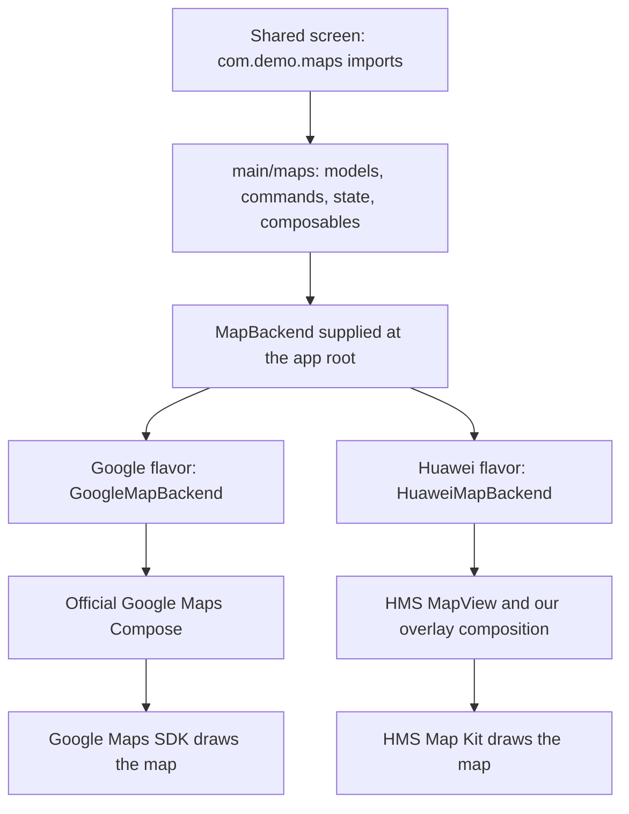

# Understand the map structure and its effect on existing Google code

Read sections **1, 3, and 5** first to understand the shared code and its Google-side
impact. Section **2** is the folder lookup. Sections **6 and 8** cover risks and the
alternative that preserves more native Google behavior. The remaining sections
trace execution and separate reusable infrastructure from demo-only code.

## 1. The important answer first

**`main/java/com/demo/maps` is a custom compatibility API that this project owns.**
It contains more than forwarding functions: it defines coordinates, camera commands,
camera/marker state, configuration objects, and the interface implemented by each SDK.
Both the Google and Huawei flavors use it for screens migrated to `com.demo.maps`.

Your concern about Google-side impact is justified. The Google SDK still draws the
map, but migrated screens now pass through our types and state adapters first.
**Changing imports can preserve source code while changing its execution path. An
import-only diff does not prove identical runtime behavior.**

The current design trades more centrally maintained compatibility code for fewer
changes inside individual screens. It is one possible design, not a requirement
imposed by build flavors. Section 8 explains an alternative that retains Google's
original models/state in the Google flavor.

Nothing here adds another Gradle module. Settings includes only:

```kotlin
include(":app")
```

## 2. Where everything lives

`maps` is a Kotlin package directory inside the existing app, not a Gradle module.
The following tree shows the parts involved in this integration; ordinary launcher
resources and unrelated project files are omitted.

```text
hmsComposeApp/
├── settings.gradle.kts                       # Includes only :app
├── app/
│   ├── build.gradle.kts                      # Existing google/huawei flavors
│   └── src/
│       ├── main/
│       │   └── java/com/demo/
│       │       ├── maps/                     # Shared compatibility implementation
│       │       │   ├── MapsInitializer.kt
│       │       │   ├── CameraUpdate.kt
│       │       │   ├── backend/MapBackend.kt
│       │       │   ├── compose/
│       │       │   │   ├── MapComposables.kt
│       │       │   │   ├── MapOptions.kt
│       │       │   │   └── MapState.kt
│       │       │   └── model/
│       │       │       ├── Geometry.kt
│       │       │       └── MapResources.kt
│       │       └── hmscomposeapp/            # This demonstration application
│       │           ├── MainActivity.kt
│       │           ├── MapDemoScreen.kt
│       │           ├── MapDemoState.kt
│       │           ├── DemoMapData.kt
│       │           ├── LiveRideDemoScreen.kt
│       │           ├── map/MapProvider.kt
│       │           ├── locationpicker/...
│       │           ├── ui/theme/...
│       │           └── busondemand/
│       │               ├── BusOnDemandRideMap.kt
│       │               └── BusOnDemandDemoSupport.kt
│       ├── google/
│       │   ├── AndroidManifest.xml           # Google map API-key metadata
│       │   ├── res/raw/                      # Google-format map styles
│       │   └── java/com/demo/
│       │       ├── maps/google/GoogleMapBackend.kt
│       │       └── hmscomposeapp/map/
│       │           ├── PlatformMapProvider.kt
│       │           └── PlatformLocationProvider.kt
│       ├── huawei/
│       │   ├── agconnect-services.json       # Existing HMS client configuration
│       │   ├── res/raw/                      # HMS-format map styles
│       │   ├── resources/META-INF/           # Packaged source-license notices
│       │   └── java/com/demo/
│       │       ├── maps/huawei/
│       │       │   ├── HuaweiMapBackend.kt
│       │       │   ├── HuaweiMapHostView.kt
│       │       │   ├── HuaweiMapApplier.kt
│       │       │   ├── HuaweiCameraController.kt
│       │       │   └── ComposeMarkerRenderer.kt
│       │       └── hmscomposeapp/map/
│       │           ├── PlatformMapProvider.kt
│       │           └── PlatformLocationProvider.kt
│       ├── test/java/                       # Unit tests, executed per flavor
│       └── androidTest/java/                # Native renderer and demo UI tests
├── scripts/                                 # Inventory, migration, comparison, APK checks
├── docs/reference/bus-on-demand/             # Reference, migrated copy, exact diff
└── .github/workflows/maps.yml                # Build/test/isolation workflow
```

An app built as `googleDebug` compiles `main + google + debug` sources. A
`huaweiDebug` build compiles `main + huawei + debug`. The same principle applies to
release builds. The Google and Huawei native implementations do not compile together
in one variant. They share the `main` code.

## 3. What the eight shared files actually do

All links below point to the implementation, not a separate library module.

| File | What it owns | Does it contain behavior? |
| --- | --- | --- |
| [Geometry.kt](../app/src/main/java/com/demo/maps/model/Geometry.kt) | Shared `LatLng`, `LatLngBounds`, `CameraPosition` | Yes: validation, coordinate normalization, equality, bounds building/containment, antimeridian handling. |
| [MapResources.kt](../app/src/main/java/com/demo/maps/model/MapResources.kt) | Style JSON, icon descriptions, callback handle interfaces | Resource loading and image descriptions; it does not draw a map. |
| [MapOptions.kt](../app/src/main/java/com/demo/maps/compose/MapOptions.kt) | Properties, settings, map type, overlay options | Mostly configuration data/defaults, plus zoom-range validation. |
| [CameraUpdate.kt](../app/src/main/java/com/demo/maps/CameraUpdate.kt) | `CameraUpdateFactory` and semantic camera commands | Creates/validates descriptions of camera actions; it does not execute them. |
| [MapState.kt](../app/src/main/java/com/demo/maps/compose/MapState.kt) | Camera/marker state, command waiting, cancellation, ownership, savers | **Yes. This is a significant compatibility layer and an important regression-test target.** |
| [MapBackend.kt](../app/src/main/java/com/demo/maps/backend/MapBackend.kt) | Backend/controller interfaces and event bundles | Defines how shared code communicates with a native implementation. |
| [MapComposables.kt](../app/src/main/java/com/demo/maps/compose/MapComposables.kt) | Familiar functions such as `GoogleMap`, `MarkerComposable`, `Polygon` | Supplies the backend to descendants and forwards calls/options/events. It does not implement the base-map renderer. |
| [MapsInitializer.kt](../app/src/main/java/com/demo/maps/MapsInitializer.kt) | Compatibility entry point for SDK initialization | Uses the backend installed at the root; initialization order matters. |

### 3.1 `model` contains our types, not Google's actual classes

These names look familiar deliberately, but they have different type identities:

```kotlin
import com.demo.maps.model.LatLng as SharedLatLng
import com.google.android.gms.maps.model.LatLng as GoogleLatLng

val shared = SharedLatLng(24.7, 46.6)
val native = GoogleLatLng(shared.latitude, shared.longitude)

// This would not compile: these are different classes.
// val wrong: GoogleLatLng = shared
```

The Google backend performs that coordinate conversion. The Huawei backend creates
an HMS coordinate from the same shared latitude/longitude. There is no direct cast
between SDK objects.

`Geometry.kt` also implements bounds calculations. That helps preserve expressions
such as `LatLngBounds.builder().include(point).build()` in a shared screen, but it
means we own that calculation and its edge cases.

The shared `LatLng` is **not Parcelable**. Existing saved objects, navigation
arguments, Java APIs, or precompiled libraries expecting a Google `LatLng` need
explicit integration. A matching constructor name does not preserve binary or
serialization compatibility.

Why is there also `locationpicker/LatLongitude.kt`? That is the demo's existing
Parcelable location-picker model. The demo adapter in `map/MapProvider.kt` converts
it to the Google-shaped shared `LatLng`. It is application data, whereas the new
`LatLng` is the map compatibility contract. This duplication is an integration
choice, not another native map SDK.

### 3.2 `MapOptions` is configuration data

For example:

```kotlin
val properties = MapProperties(
    isTrafficEnabled = false,
    mapType = MapType.NORMAL,
)
```

Creating this object does not call either SDK. The selected backend translates its
fields into native settings. Defaults and supported fields are still part of the
behavior we must check; this is only the implemented subset of the familiar API.

`MapStyleOptions` carries JSON text. The bridge does not translate Google's style
JSON into HMS JSON. Separate flavor resources use the same `R.raw` names so the
screen's resource-loading code can stay the same.

### 3.3 `CameraUpdate` describes an action

The following screen code can be written before a native map is ready:

```kotlin
val update = CameraUpdateFactory.newLatLngZoom(
    LatLng(24.7, 46.6),
    15f,
)
```

In this implementation, the factory returns a shared `CameraUpdate.Target` value.
It records the coordinate and zoom; it has not moved a map yet. Later, a native
controller converts it into a Google or HMS `CameraUpdate` and executes it.

Other command descriptions cover bounds fitting, a full camera position, scrolling,
and zoom changes. This indirection preserves the call shape while avoiding an SDK
object in shared screen code.

### 3.4 `MapState` is more than a data holder

This familiar expression now uses **our** state class:

```kotlin
val camera = rememberCameraPositionState()

LaunchedEffect(pickup) {
    camera.animate(CameraUpdateFactory.newLatLngZoom(pickup, 15f))
}
```

The shared camera state currently:

1. Reserves ownership for one map; using it for two active maps is rejected.
2. Keeps the last move requested before a controller is available.
3. Waits for controller attachment before executing an animation.
4. Cancels a previous animation when a replacement animation or move takes control.
5. Cancels pending work and releases ownership when the map disappears.
6. Receives native camera observations without issuing another move command.
7. Saves coordinates/zoom/tilt/bearing as scalar values for restoration.

`MarkerState` likewise owns observable position/drag state and connects its
info-window methods to the native marker. The two helper names differ deliberately:

```kotlin
// Initializes a remembered/saved position. Later input changes do not automatically replace it.
val remembered = rememberMarkerState(position = pickup)

// Tracks the latest input position as it changes.
val updated = rememberUpdatedMarkerState(position = vehiclePosition)
```

This file and the native/shared synchronization are the main reasons we cannot
claim that the current Google path is unaffected just because screen edits are small.

## 4. Follow one screen call through the whole system

### Step A: the build chooses the implementation

The SDK dependencies are flavor-specific in the existing app build file:

```kotlin
add("googleImplementation", "com.google.maps.android:maps-compose:8.2.2")
add("huaweiImplementation", "com.huawei.hms:maps:6.15.1.318")
```

The two `PlatformMapProvider.kt` files have the same package and function name but
live in mutually exclusive source sets:

```kotlin
// src/google/.../PlatformMapProvider.kt
fun createMapBackend(): MapBackend = GoogleMapBackend
```

```kotlin
// src/huawei/.../PlatformMapProvider.kt
fun createMapBackend(): MapBackend = HuaweiMapBackend
```

Only one definition enters a build. There is no per-screen manufacturer check or
automatic runtime switch between providers.

### Step B: the application root supplies that implementation

The current `MainActivity` contains:

```kotlin
HmsComposeAppTheme {
    ProvideMapBackend(createMapBackend()) {
        MapDemo()
    }
}
```

`ProvideMapBackend` installs/initializes the backend and makes it available to
descendant composables through `LocalMapBackend`, a Compose `CompositionLocal`.
The screen does not need a backend parameter on every function.

Every entry point rendering the shared map API needs this root provision. The
optional explicit `MapsInitializer.initialize(context)` call also needs the backend
installed first. The initializer registry assumes one selected provider per process;
this implementation is not a general multi-provider runtime routing system.

### Step C: the screen calls the shared API

```kotlin
import com.demo.maps.compose.GoogleMap
import com.demo.maps.compose.Marker
import com.demo.maps.compose.rememberUpdatedMarkerState

GoogleMap(cameraPositionState = camera) {
    Marker(state = rememberUpdatedMarkerState(vehiclePosition))
}
```

The name `GoogleMap` is retained for source compatibility. Its **import** determines
which function this is. In `MapComposables.kt`, our function forwards to
`LocalMapBackend.current.Map(...)`; marker/polygon/line functions do the equivalent
forwarding for their overlay type.

The following diagram shows the two build alternatives. Only the selected native
branch is packaged in a particular APK:



### Step D: the Google backend adapts, then delegates

For camera state, the backend creates an official Google state internally:

```kotlin
val nativeState = remember(cameraPositionState) {
    NativeCameraState(cameraPositionState.position.native())
}
```

Here `cameraPositionState` is our shared object; `NativeCameraState` is an import
alias for Google's official `CameraPositionState`. They are two separate objects.
Our controller sends commands to the native state, and `snapshotFlow` copies native
camera observations back into shared state. Marker state has a similar two-way
connection, with special handling for user dragging.

`NativeMap`, `NativeMarker`, and other aliases in that file call the official Google
library. Google still owns its renderer and native view lifecycle. Our new adapters
own the conversion, added state coordination, shared callback handles, and readiness
connection. That is why the one Google file contains meaningful behavior despite
delegating most rendering work.

### Step E: the Huawei backend supplies the Compose integration

HMS uses a native `MapView` in this project, so the backend implements the map-content
composition that the Google Compose dependency already supplies on the other side:

| Huawei file | Role in this call path |
| --- | --- |
| [HuaweiMapBackend.kt](../app/src/huawei/java/com/demo/maps/huawei/HuaweiMapBackend.kt) | Embeds the Android view and starts the map-content composition. |
| [HuaweiMapHostView.kt](../app/src/huawei/java/com/demo/maps/huawei/HuaweiMapHostView.kt) | Forwards lifecycle, saves/restores native view state, waits for layout, cleans up. |
| [HuaweiMapApplier.kt](../app/src/huawei/java/com/demo/maps/huawei/HuaweiMapApplier.kt) | Retains overlay nodes, applies changes, removes native objects, and routes events by ID. |
| [HuaweiCameraController.kt](../app/src/huawei/java/com/demo/maps/huawei/HuaweiCameraController.kt) | Converts camera commands and bridges native animation callbacks to coroutines. |
| [ComposeMarkerRenderer.kt](../app/src/huawei/java/com/demo/maps/huawei/ComposeMarkerRenderer.kt) | Draws custom Compose marker content into a bitmap and refreshes its icon. |

For example, a changed vehicle coordinate updates an existing native marker's
position. Removing a keyed marker declaration removes its native marker. A polygon
with holes becomes an HMS polygon with hole rings. This coordination is centralized;
the screen does not perform native view lifecycle or overlay bookkeeping itself.

HMS initial movement waits for layout. Its animations additionally wait for the
first native loaded frame because an earlier device test exposed a startup animation
completion problem. This is an intentional backend-specific readiness rule.

## 5. What changes for the existing Google app?

**Adding the folder does not redirect untouched Google imports.** A screen that
still imports `com.google.maps.android.compose.GoogleMap` continues calling the
official Google function in a Google build. Once its imports change to
`com.demo.maps`, it takes the new compatibility path.

```text
Before migration:
screen -> official Google Maps Compose -> Google SDK

After migration, Google flavor:
screen -> our shared API/state -> Google adapter -> official Maps Compose -> Google SDK

After migration, Huawei flavor:
same screen -> our shared API/state -> Huawei adapter/Compose integration -> HMS SDK
```

| Area | Current Google-side effect |
| --- | --- |
| Base-map rendering and tiles | Still performed by the official Google SDK. |
| Google Compose native view/overlay machinery | Still supplied by the official library. |
| Screen-facing coordinates, bounds, properties, commands | Replaced with our shared types after import migration. |
| Screen-facing camera/marker state | Replaced with our shared state and connected to native Google state. |
| Callback marker/overlay objects | Shared handle interfaces, not the complete Google SDK classes. |
| Initialization | Goes through the root-provided backend/compatibility initializer. |
| Application business logic | Intended to stay in existing screens; small source diffs need runtime verification. |

### Why changing one screen's imports might not be sufficient

Helpers and producers must agree on the type they exchange. For example, this
combination is incompatible:

```kotlin
fun loadPickup(): com.google.android.gms.maps.model.LatLng = TODO()

@Composable
fun RideMap(pickup: com.demo.maps.model.LatLng) { /* shared map calls */ }

// RideMap(loadPickup()) // Different coordinate types: this would not compile.
```

The producer/helper also needs the shared import, or a conversion at its boundary.
This can affect view models, UI-state models, navigation, utilities, and repositories
if they already expose Google types. A precompiled dependency cannot be migrated by
editing imports in its caller.

For the supplied screen, the [comparison diff](reference/bus-on-demand/imports-only.diff)
contains 12 map import changes and one qualified initializer reference change.
Names/assets were neutralized consistently in both reference copies separately.
That demonstrates this file's source preservation, not the coverage of every API
used by the unavailable 120-file application.

## 6. Risk assessment: where regression testing matters

| Area | Concrete risk | Existing mitigation and remaining work |
| --- | --- | --- |
| Shared geometry | Validation, normalization, bounds/antimeridian behavior can differ at edge cases. | Geometry unit tests exist; compare against actual production coordinate/bounds cases. |
| Camera state | Readiness, queued commands, interruption, gestures, disposal and restoration now pass through extra coordination. | Unit/native tests cover representative cases; test real navigation and competing camera effects. |
| Marker state | Synchronization between app position and native dragging can change timing or cause feedback problems. | Retained-state logic handles dragging; validate actual drag/live-update interactions. |
| Persistence/type identity | Existing Google Parcelables, saved objects, Java callers, serializers and SDK-bound libraries are not the same types. | Shared state savers use scalars; no automatic migration of all production SDK objects is implemented. |
| Custom marker UI | Bitmap refresh rules, keys, anchors, density and animated visuals can differ between renderers. | Native pixel/identity tests exist; verify actual production assets and peak workload. |
| API coverage | `MapEffect`, clustering, Street View, advanced markers, projection, line patterns/caps and other APIs are outside this subset. | Inventory first; unsupported uses need adapters rather than an automatic import rewrite. |
| Styling/SDK differences | Matching resource names and parameters do not guarantee identical map appearance or native behavior. | Provider-specific resources and explicit conversions; visual/device parity is still required. |
| SDK upgrades | Changes in either SDK or Maps Compose can require updating this compatibility layer. | Versions are pinned in the demo; test upgrades separately from migration. |

The shared API is not the entire Google SDK recreated. It is a deliberately limited
implementation of the currently demonstrated calls. The risky part is the behavior
we own, not simply the number of files.

The current demo has 20 unit tests per flavor and 6 Python migration/comparison
tests. A 10-test Google emulator suite passed for the preserved screen. Earlier
Huawei device tests exercised the bridge, but the latest exact-screen revision was
not retested on physical Huawei hardware. A separate GMS-unavailable emulator
experiment could not load an HMS map delegate. These limits are recorded in
[map-validation.md](map-validation.md); the evidence is not a zero-regression
guarantee for the production app.

## 7. Which code belongs to the demo, not the reusable bridge?

| Area | Purpose | Production adoption |
| --- | --- | --- |
| `com.demo.maps` shared package and native flavor implementations | Compatibility contract and SDK integration | These are the implementation to evaluate/integrate. |
| `MainActivity` root provision and flavor factories | Connect a build to its backend | Adapt to existing application entry points/dependency injection. |
| `map/MapProvider.kt` | Older small launcher/picker adapter using the shared API | Demo-specific; complex screens do not need this extra small-screen interface. |
| `LocationProvider` / `PlatformLocationProvider` | Current-location service | Separate concern; map rendering does not migrate all location APIs. |
| `LiveRideDemoScreen` | Controls, fake transport batches and a readiness observer around the supplied screen | Demo harness; not required in each production screen. |
| `BusOnDemandDemoSupport` and demo drawables | Stand-ins for unavailable production helpers/assets | Keep the real application's implementations instead. |
| `DemoMapData` | Static sample coordinates/route | Not a production directions service. |
| `MapDemoScreen`, `MapDemoState`, `locationpicker`, `ui/theme` | Launcher/picker UI, domain state and styling | Existing demonstration app, not required infrastructure for 120 screens. |
| Tests, scripts and CI workflow | Source comparison, behavior checks, dependency/APK isolation | Reuse relevant checks with existing test infrastructure; no extra test modules are required. |

The two similarly named interfaces have different levels: the demo's **MapProvider**
offers a small marker/route screen, while **MapBackend** is the low-level contract
behind the Google-shaped Compose API. Your supplied complex map calls the latter
through shared composables; it is not being rewritten into the small MapProvider
interface.

## 8. Could we reduce the impact on the Google flavor further?

**Yes. The current custom shared-state design is not the only way to minimize
screen edits.** An alternative is a flavor-specific compatibility API using the
same application-owned import names, but native aliases/forwarding on Google.

For example, an alternative Google-only source file could contain:

```kotlin
// Alternative design only: app/src/google/.../model/LatLng.kt
package com.demo.maps.model

typealias LatLng = com.google.android.gms.maps.model.LatLng
```

A Google-only state file could similarly alias the official state:

```kotlin
// Alternative design only: app/src/google/.../compose/CameraPositionState.kt
package com.demo.maps.compose

typealias CameraPositionState = com.google.maps.android.compose.CameraPositionState
```

Then the Google screen's new application-owned imports would resolve to the real
Google types, reducing custom state synchronization on that side. Matching Huawei
source files would expose the same names using HMS-compatible implementations.

These snippets are **not additions to the current implementation**. Its shared
classes of the same names would first have to be moved/replaced. Main and flavor
sources compile together; declaring both definitions would conflict. A typealias
also does not produce a new JVM class or rewrite compiled libraries.

| Choice | Main benefit | Cost/tradeoff |
| --- | --- | --- |
| Current design: common models/state + native adapters | Stable provider-independent types in shared code; consistent place for common command/state rules. | Custom geometry/state semantics also sit on the migrated Google path. |
| Flavor-specific API with native Google aliases/forwarding | Preserves more of the existing Google type/state behavior behind new imports. | Public underlying types differ by variant; helper APIs, persistence, Java/binary dependencies and the real module graph must be checked. |
| Keep separate provider-specific screen implementations | Can leave the existing Google screen implementation more isolated. | Duplicated screens and continuing maintenance, especially expensive across 120 files. |

For one app module containing Kotlin source screens, the alias/forwarding approach
deserves a prototype if protecting Google behavior is the highest priority. If the
production app has separately compiled feature libraries, it is not automatically
a drop-in alternative: variant matching and SDK types crossing library boundaries
need inspection. It does not require new Gradle modules by itself.

This guide does not change the chosen implementation. The correct production
decision needs that application's dependency/type inventory; the demo alone cannot
settle it.

## 9. A practical review order before applying this to 120 files

1. Read [MapComposables.kt](../app/src/main/java/com/demo/maps/compose/MapComposables.kt)
   to see what a migrated screen actually calls.
2. Read [MapState.kt](../app/src/main/java/com/demo/maps/compose/MapState.kt) and
   [Geometry.kt](../app/src/main/java/com/demo/maps/model/Geometry.kt) to review the
   new behavior/types introduced on both providers.
3. Read [GoogleMapBackend.kt](../app/src/google/java/com/demo/maps/google/GoogleMapBackend.kt)
   to see exactly what is converted, synchronized, or delegated to official Google code.
4. Read [HuaweiMapBackend.kt](../app/src/huawei/java/com/demo/maps/huawei/HuaweiMapBackend.kt)
   and follow its commented reading order through the native implementation.
5. Inventory the real app with `scripts/map_inventory.py`. Inspect both imports and
   exposed types in shared helpers/models, not just the screen file count.
6. Compare the current shared-state implementation with a native-Google alias
   prototype on representative production screens before broad migration.
7. Keep existing behavior tests; add relevant checks for readiness/cancellation,
   dragging, restoration, native escape hatches, and actual marker/vehicle workload.
   A folder move or import comparison is not a substitute for these checks.

Use [map-compatibility.md](map-compatibility.md) for the supported API contract,
exact screen comparison, migration commands and build checks. This file explains
the ownership, runtime paths and tradeoffs behind that implementation.
